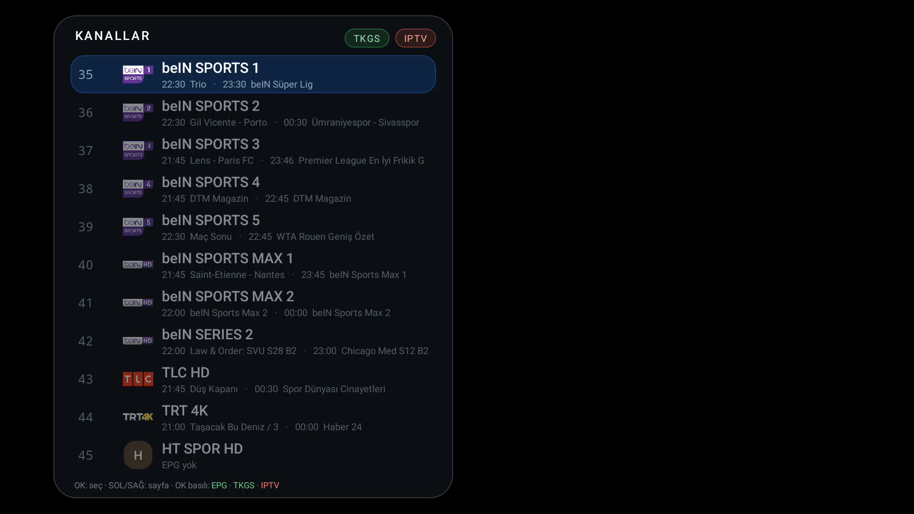
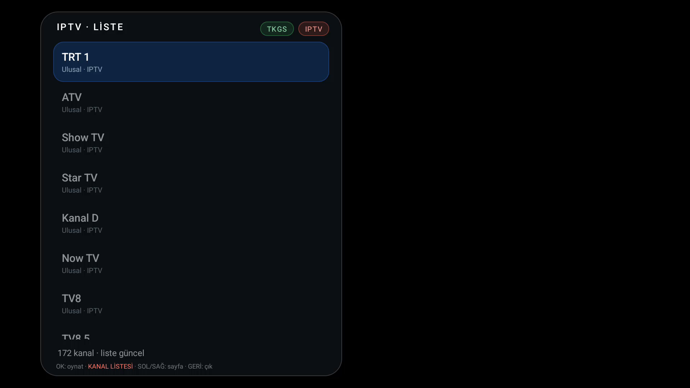
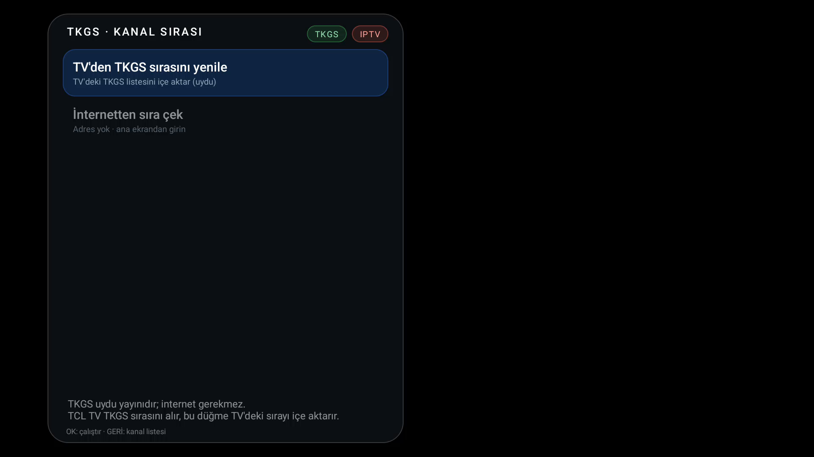
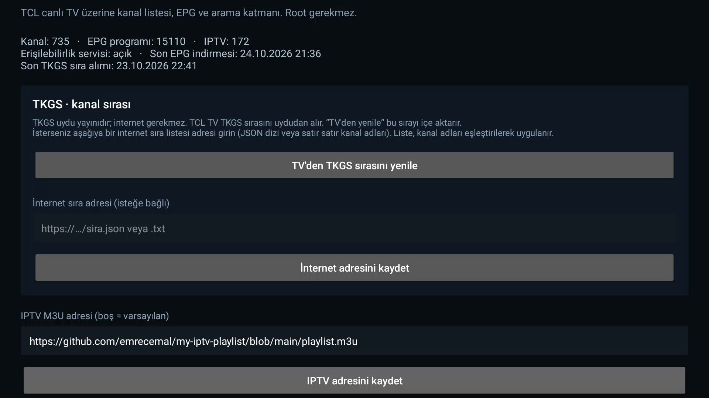

# TCL Live+ (root gerektirmez)

TCL Android TV'lerde canlı TV deneyimini geliştiren, root gerektirmeyen bir katman uygulaması.
TCL'in kendi kanal listesini değiştirmez; erişilebilirlik servisi + overlay ile onun üzerine biner.
Kumandadan OK'a basınca TCL'in listesi yerine bu katman açılır.

> Bu proje TCL ile resmî bağlantılı değildir. TCL adı, kanal adları ve logolar ilgili sahiplerine aittir.

## Ekran görüntüleri

| Kanal listesi | IPTV listesi |
|---|---|
|  |  |

| TKGS kanal sırası | Ayarlar |
|---|---|
|  |  |

## Özellikler

- OK ile açılan yarı saydam kanal listesi; Türkçe kanal logoları APK içinde gömülü (`assets/logos`)
- EPG internetten (XMLTV, varsayılan: `epgshare01 TR1`) — uydu EPG'si kullanılmaz
- TKGS kanal sırası desteği
- IPTV: varsayılan M3U listesi otomatik indirilir; Ayarlar'dan özel M3U adresi girilebilir
- IPTV oynatıcı: TextureView + MediaPlayer; HLS/MP4 akışları
- IPTV oynatıcıda UP/DOWN ile önceki/sonraki kanal (liste başında/sonunda döngülü)
- IPTV oynatıcıda OK ile IPTV listesine dönüş, GERİ ile canlı TV'ye çıkış
- IPTV listesinde UP/DOWN gezinme (basılı tutunca hızlı kaydırma), LEFT/RIGHT sayfa
- IPTV oynatıcıda YEŞİL ile ekran modu: Sığdır / Doldur / Kırp
- YouTube tuşu ile YouTube TV'yi açma
- Yeniden başlatma sonrası ayarların ve servis durumunun korunması

## Kurulum

1. [Releases](../../releases) sayfasından `TCL-Live-Plus.apk` dosyasını indir.
2. TV'ye yükle:

   ```bash
   adb install -r TCL-Live-Plus.apk
   ```

3. TV'de: **Ayarlar → Erişilebilirlik → TCL Live+** servisini aç.
4. Uygulamayı açıp kanalları içe aktar veya IPTV M3U adresini ayarla.

## Kanalları içe aktarma

1. Uygulamada **Kanalları içe aktar** seçeneğine gir.
2. TV'de OK ile TCL'in kendi listesini aç, birkaç saniye gez.
3. GERİ'ye bas, ardından **İçe aktarmayı bitir** seçeneğini kullan.

Kanal numaraları TCL'in kendi numaralarıdır; içe aktarma bunları otomatik toplar.

## Kumanda

| Bağlam | Tuş | İşlev |
|---|---|---|
| Kanal listesi | OK | Kanal seç |
| Kanal listesi | UP / DOWN | Gezin |
| Kanal listesi | LEFT / RIGHT | Sayfa (basılı tutunca seri sayfa) |
| Kanal listesi | OK (basılı) | EPG |
| Kanal listesi | YEŞİL | TKGS |
| Kanal listesi | KIRMIZI | IPTV |
| Kanal listesi | GERİ | Kapat |
| IPTV listesi | OK | Oynat |
| IPTV listesi | UP / DOWN | Gezin (basılı tutunca hızlı kaydırma) |
| IPTV listesi | LEFT / RIGHT | Sayfa |
| IPTV listesi | KIRMIZI | Kanal listesi |
| IPTV listesi | GERİ | Canlı TV |
| IPTV oynatıcı | UP / DOWN | Önceki / sonraki kanal (döngülü) |
| IPTV oynatıcı | OK | IPTV listesi |
| IPTV oynatıcı | GERİ | Canlı TV |
| IPTV oynatıcı | YEŞİL | Ekran modu: Sığdır / Doldur / Kırp |
| EPG | OK / GERİ | Kanal listesi |
| TKGS | OK | Çalıştır |
| TKGS | GERİ | Kanal listesi |
| Her yerde | YouTube | YouTube TV |

## Ayarlar

- EPG adresi (XMLTV / `.xml.gz`)
- Tuner modu: `dvbs` (uydu), `dvbt` (karasal), `dvbc`
- OK yakalama aç/kapat
- IPTV M3U adresi (boş bırakılırsa varsayılan liste kullanılır)

## Derleme

Gereksinimler: JDK 17+, Android SDK build-tools 34+ ve platform android-34.

```powershell
powershell -ExecutionPolicy Bypass -File build.ps1
```

Gradle yok: `aapt2 → javac → d8 → zipalign → apksigner`.
Çıktı: `TCL-Live-Plus.apk`.

`build.ps1` varsayılan olarak `debug.keystore` kullanır; yoksa otomatik oluşturur.
Bu dosya `.gitignore` içindedir. Herkese açık sürüm için kendi release anahtarınızı kullanın ve anahtarı asla depoya eklemeyin.

## Sınırlar

- TCL firmware güncellemesi `TVActivity` intent veya erişilebilirlik davranışını değiştirirse kanal değiştirme bozulabilir; liste/EPG çalışmaya devam eder.
- Erişilebilirlik servisi kapatılırsa her şey TCL'in orijinal davranışına döner.
- OK yakalandığı için TCL'in kendi bilgi çubuğu OK davranışları devre dışı kalır (kapatılabilir).
- Root yoktur; TCL tuner'ı veya sistem uygulamaları değiştirilmez.
- IPTV kanallarının oynatılabilirliği kaynağa ve cihazın MediaPlayer codec desteğine bağlıdır.

## Yasal not

Bu uygulama yayın içermez. IPTV M3U adresini kullanıcı sağlar; varsayılan liste üçüncü taraf bir GitHub deposundan indirilir.
Yalnızca yayın haklarına sahip olduğunuz veya yasal olarak erişim yetkiniz olan içerikleri kullanın.
